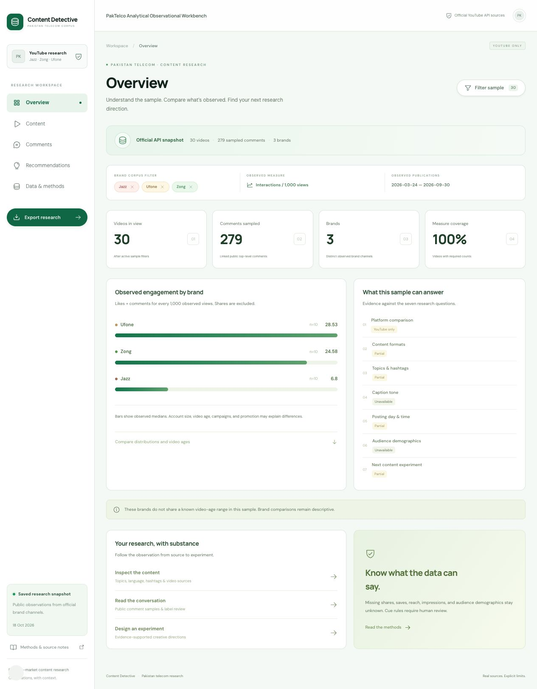

# 🇵🇰 Pakistani Social Media Content Detective

A student digital-marketing investigation: **What type of social-media content gets Pakistani audiences to engage?**

The current project has a Python/Streamlit assignment dashboard (`app.py`) and a matching Next.js web dashboard (`web/`) for Vercel. Both use the same Python analysis through `src/`; the web API entry point is `api/index.py`. Current work is **YouTube only**, with shared analysis, evidence exports, and a five-section research workflow. Instagram is deferred; its offline CSV validator remains in the codebase. The earlier ReelScope interface is no longer the web homepage.

**Current web interface:** [run the Next.js dashboard](web/README.md) · [deploy on Vercel](docs/DEPLOYMENT.md) · [feature guide](docs/FEATURE_GUIDE.md).



## Real collection completed — October 18, 2026

| Official brand | Videos | Sampled public top-level comments |
|---|---:|---:|
| Jazz | 10 | 31 |
| Zong | 10 | 140 |
| Ufone | 10 | 108 |
| **Total** | **30** | **279** |

**0 API errors; export validation passed.** Official channel identities are verified through exact corporate-site links plus `channels.list`, recorded in [config/brands.yml](config/brands.yml) and [config/brand_verification.json](config/brand_verification.json).

The user approved a common **October 1, 2025–September 30, 2026** publication window after the original April–September window contained only seven eligible Zong uploads. The collector takes the newest 10 eligible videos per brand and up to 30 newest top-level comments per video. This is a documented convenience pilot, not representative sampling. Posts have different observation ages; the dashboard shows those ages and offers an age filter. The earlier 27-video/238-comment snapshot is preserved separately.

All 30 videos have observed likes, comment counts, views, and subscriber snapshots. Shares, saves, reach, and impressions are missing on all 30 and remain blank/NULL. Subscriber counts are rounded snapshots, not the audience size at publication. Three videos returned no public comments; 27 supplied a sample. Downloaded sample size is distinct from the video's total comment metric.

Public-comment sentiment currently uses **unevaluated English/Urdu/Roman Urdu cue rules**: 14 positive, 9 negative, and 256 unassessed. These are exploratory labels, not reliable population sentiment. No human evaluation or calibrated confidence is claimed. A review-sheet download and evaluation upload are available. Caption tone is analyzed separately.

[Collection log and limitations](docs/YOUTUBE_COLLECTION_LOG.md) · [Project specification](docs/PROJECT_SPECIFICATION.md)

## Run the dashboard

Python 3.11+ is required; Python 3.12 was verified.

```bash
cd "/Users/adnan/Documents/ChatGPT/scraper tool"
python3 -m venv .venv
source .venv/bin/activate
python -m pip install -r requirements.txt
python -m streamlit run app.py
```

For the configured workspace, use `.venv/bin/python -m streamlit run app.py`. On Windows, activate `.venv\Scripts\Activate.ps1` instead.

Open the local URL, usually http://127.0.0.1:8501. The validated saved YouTube pilot loads automatically. Saved-data analysis needs no network or key. **Filter sample** controls brands, the measure, dates, video ages, and minimum group size. Three validated public-pilot files in `data/processed/` are included for deployment; raw snapshots, other generated outputs, credentials, and the local database stay Git-ignored. Without saved data, the app offers collection or documented CSV import. Synthetic imports stay explicitly labeled.

## Publish the current dashboard

For Vercel, deploy the **repository root** on branch **`main`**, with the **Services** framework preset and root `vercel.json`. This builds the current Next.js interface and shared Python API together. The included public pilot loads without an API key. See [deployment instructions](docs/DEPLOYMENT.md).

An existing Vercel project must have its Root Directory changed from `web` to the repository root so both services deploy. After that one-time configuration, pushes to `main` update the dashboard through Vercel's Git integration. Root `app.py` remains available for local Streamlit use or optional Community Cloud hosting.

## Reproduce acquisition

Put `YOUTUBE_API_KEY` in the local ignored `.env` file using `.env.example` as the template. The application and CLI load it automatically with python-dotenv; an existing environment value takes precedence. The key is sent only to Google's official YouTube endpoint, never included in raw receipts, reports, or CSV exports.

```bash
.venv/bin/python scripts/verify_youtube_channels.py
.venv/bin/python scripts/collect_youtube.py
# Resume the existing snapshot using successful raw-response caches:
.venv/bin/python scripts/collect_youtube.py --resume 20261018T070121103737Z
```

A fresh run obtains new metric snapshots. Resume keeps original response timestamps and makes no request for cached responses. The real resume test used **0 new API calls and 115 cached responses**, with no duplicate post, comment, or metric-snapshot rows. Selection/window changes require a new snapshot; refreshing verification timestamps alone does not change sample selection.

The collector uses `channels.list`, `playlistItems.list`, `videos.list`, and `commentThreads.list`, not search for known channels. It bounds enumeration to 40 playlist pages per brand and explicitly marks incomplete enumeration. It retries transient failures up to three times, stops new requests on recognized credential/quota failures, preserves unavailable comment states, filters author-profile fields, and stores raw JSON before normalization. Quota estimates describe each invocation; actual Console limits are authoritative. [Official API setup](https://developers.google.com/youtube/data/getting-started)

## Outputs

- `data/processed/youtube_posts.csv`: 30 normalized real video observations and metric snapshots, source URLs, raw lineage, post ages, and access states.
- `data/processed/youtube_comments.csv`: 279 linked top-level public comments, with no commenter profile fields; baseline labels and methods are explicit.
- `data/processed/normalized_posts.csv`: the active YouTube normalized export; no Instagram rows have been invented or collected.
- `data/processed/youtube_collection_report.json`: brand counts, missing fields, validation, errors, sampling, and request/cache audit.
- `data/processed/youtube_findings.md`: computed seven-question report, source examples, and comment-sample limitations.
- `data/processed/sentiment_review_template.csv`: review sheet; no blank label is treated as ground truth.
- `data/raw/<run_id>/`: timestamped endpoint responses, immutable snapshot selection, CSVs, summary, and per-invocation logs.
- `data/detective.sqlite`: brand/account identities, unique posts, separate metric snapshots, linked comments, and collection runs.

SQLite post uniqueness is `(platform, platform_post_id)`; metric-snapshot uniqueness also includes the actual observation time. Re-running the same snapshot is idempotent. A new snapshot may legitimately add measurements for existing posts.

[Plain-language guide to every feature](docs/FEATURE_GUIDE.md)

## Five-section research workflow

1. **Overview:** inspect the real sample, measure coverage, brand medians, distributions, video ages, and support for the seven questions.
2. **Content:** explore suggested or reviewed topics/language, hashtags, Karachi publishing patterns, and the searchable source video library. Sparse day/hour slots do not produce a posting-time recommendation.
3. **Comments:** read linked public-comment samples, distinguish cue labels from unassessed text, download a review sheet, and evaluate only when human labels are uploaded.
4. **Recommendations:** inspect evidence-supported content experiments and source examples. Download a computed writing brief for an AI assistant; this makes no AI model call.
5. **Data & methods:** inspect provenance and missingness, review content labels with a reviewer/codebook note, reload or refresh the pilot, import documented CSVs, and export the active filtered research sample.

Caption language and local-context labels describe content, not viewer demographics. The current brands have **no overlapping observed video-age range**, so brand comparisons remain descriptive. No joint day/hour cell reaches the default five-video threshold. Rule-based categories and sentiment require human review; a trained or validated model is not claimed.

The UI uses a Google Stitch reference adapted to native Streamlit widgets and real computed Plotly charts. See [design and Phase 3 notes](docs/PHASE_3_UI.md) and the [actual overview preview](docs/phase3-overview.jpg).

## Reproduce Phase 3 offline

```bash
.venv/bin/python scripts/analyze_youtube.py
```

This validates and reads the saved source CSVs, applies the shared pipeline, and writes derived outputs without API calls or changes to the source exports:

- `data/processed/youtube_analysis_posts.csv`: analyzed observations with a guarded within-brand median index.
- `data/processed/youtube_analysis_*.csv`: brand, missingness, hashtag, day/hour, category, and language tables.
- `data/processed/youtube_analysis_summary.json`: counts, definitions, thresholds, age comparability, cue coverage, and limits.
- `data/processed/youtube_phase3_report.md`: computed findings and source examples.
- `data/processed/youtube_phase3_evidence.zip`: the report, analyzed rows, matched sampled comments, tables, manifest, filters, and quality checks.

Dashboard exports apply the active filters and only include comments linked to the selected videos. An index of 1.0 means the observed within-brand median; it is not predicted performance.

## Instagram fallback and comparison limits

The deferred Instagram module supplies `instagram_posts.csv` headers and a strict validator/importer; it is not exposed in the YouTube dashboard. Required provenance includes a handle, verification URL, post URL, offset-aware publication/collection timestamps, and `source_method=manual_public`. Likes/comments/views/followers may stay blank. Five-row fixture tests verify the importer; **no real Instagram records or Business Discovery access have been tested**. It makes no Instagram network requests.

Compare posts within one platform first. Visible interactions require both likes and comments. Visible interactions per 1,000 views exclude shares and are not a percentage of people. The follower-normalized public-interaction proxy also requires a positive observed follower snapshot; it is not a reach-based rate. Views and follower definitions differ across platforms. No universal platform winner, demographic response rate, causal posting-time effect, or guaranteed view lift is claimed.

Only identical imported rows are removed. Conflicting source/account/post identities are flagged and retained in exports but excluded from analysis. Unknown counts remain missing. Karachi time analysis requires explicit timezone evidence. Recommendations need at least two groups with default n ≥5 and ≥80% metric coverage; these are exploratory guardrails, not statistical confidence.

## Verification and notebooks

```bash
.venv/bin/python -m pytest -q
.venv/bin/python scripts/execute_notebook.py --notebook notebooks/youtube_pilot_analysis.ipynb
.venv/bin/python scripts/execute_notebook.py
```

The real-pilot notebook uses the same modules as the dashboard. The original notebook remains a synthetic educational example. Tests use controlled fixtures, separately from the live acquisition and real cache-resume audits. See [verification](docs/VERIFICATION.md), [methodology](docs/METHODOLOGY.md), and [limitations](docs/LIMITATIONS.md).
